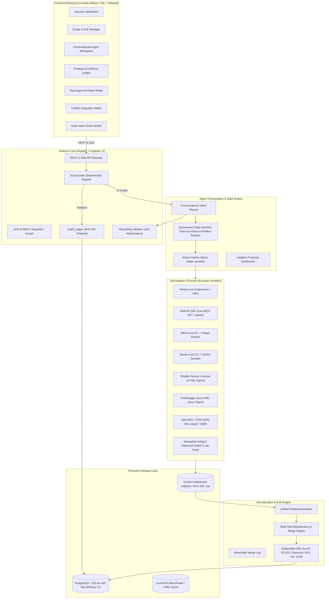
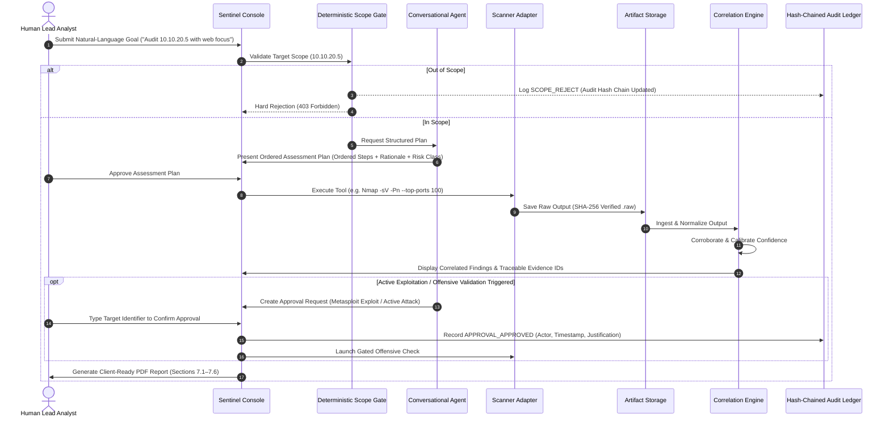

# SentinelVAPT: Production Platform Architecture

```
███████╗███████╗███╗   ██╗████████╗██╗███╗   ██╗███████╗██╗     ██╗   ██╗ █████╗ ██████╗ ████████╗
██╔════╝██╔════╝████╗  ██║╚══██╔══╝██║████╗  ██║██╔════╝██║     ██║   ██║██╔══██╗██╔══██╗╚══██╔══╝
███████╗█████╗  ██╔██╗ ██║   ██║   ██║██╔██╗ ██║█████╗  ██║     ██║   ██║███████║██████╔╝   ██║   
╚════██║██╔══╝  ██║╚██╗██║   ██║   ██║██║╚██╗██║██╔══╝  ██║     ╚██╗ ██╔╝██╔══██║██╔═══╝    ██║   
███████║███████╗██║ ╚████║   ██║   ██║██║ ╚████║███████╗███████╗ ╚████╔╝ ██║  ██║██║        ██║   
╚══════╝╚══════╝╚═╝  ╚═══╝   ╚═╝   ╚═╝╚═╝  ╚═══╝╚══════╝╚══════╝  ╚═══╝  ╚═╝  ╚═╝╚═╝        ╚═╝   
```

**System:** SentinelVAPT (Autonomous, Evidence-Driven Security Assessment Platform)  
**Classification:** Enterprise Security Architecture  
**Standards Alignment:** NIST SP 800-115, OWASP WSTG, CWE, CVE, CVSS v3.1, MITRE ATT&CK  

---

## 1. System Overview & Core Tenets

SentinelVAPT is an evidence-driven, conversational security assessment platform engineered for professional vulnerability assessment and penetration testing (VAPT) consultancies. It automates testing workflows from initial reconnaissance through to client-ready reporting, with an unbreakable architectural guarantee: **the human analyst remains in deterministic control of all consequential actions.**

### Core Tenets:
1. **Zero Hallucination Guarantee:** No scanner output, CVE, CVSS vector, or risk score is ever fabricated. Every reported issue links to immutable machine artifacts.
2. **Deterministic Scope Gate:** Scope enforcement is 100% deterministic Python code (`ipaddress`, socket pinning, DNS pre-resolution). The LLM cannot bypass it.
3. **Dual Human Approval Gates:** Action-level approvals for active exploitation/intrusive attacks, and report-level approvals prior to client delivery.
4. **Strict Separation of Evidence vs. Inference:** Raw machine outputs (`OBSERVED EVIDENCE`) are stored immutably with SHA-256 hashes; model deductions (`AI INFERENCE`) carry calibrated confidence scores (0–100%) and link to evidence IDs.
5. **Cryptographically Chained Audit Ledger:** Blockchain-style append-only ledger where record $N$ stores $\text{SHA-256}(Record_{N-1})$.

---

## 2. High-Level Architecture Diagram



---

## 3. Data Flow & Execution Pipeline



---

## 4. Key Architectural Subsystems

### 4.1 Deterministic Scope Gate
- Pure Python mathematical evaluation using `ipaddress` and socket pinning.
- Blocks public IPv4/IPv6 ranges by default.
- Prevents DNS rebinding by resolving hostnames prior to tool execution and confirming all resolved IPs are inside the authorized CIDR.
- Sanitizes URLs to eliminate userinfo spoofing (`http://authorized@evil.com`).

### 4.2 Adaptive State Machine (Plan -> Act -> Observe -> Reflect -> Replan)
- Tracks discovered assets, open ports, and identified technology stacks.
- Deduplicates scanner actions using action hashes $H(tool, target, parameters)$ to prevent repetitive loops.
- Synthesizes next-step proposals ("Why this scan now") that explicitly cite triggering Evidence IDs.

### 4.3 Multi-Tool Correlation & Deduplication Engine
- Matches vulnerabilities based on composite keys: `(asset, port, normalized_cve)` or `(asset, path, cwe)`.
- Cross-tool corroboration increases confidence to $\ge 0.90$.
- Single-source version banner detections are flagged as `suspected` with automated false-positive triage inferences.
- Generates a transparent `merge_log` and preserves original findings in `_unmerged_items` for 1-click unmerging.

### 4.4 Cryptographic Audit Ledger
- Append-only blockchain-style ledger.
- Record $N$ calculates $\text{SHA-256}(id \parallel ts \parallel aid \parallel actor \parallel action \parallel target \parallel payload\_hash \parallel prev\_hash)$.
- Provides a verification endpoint `/api/audit/integrity` that scans the ledger and pinpoints any tampered records.

